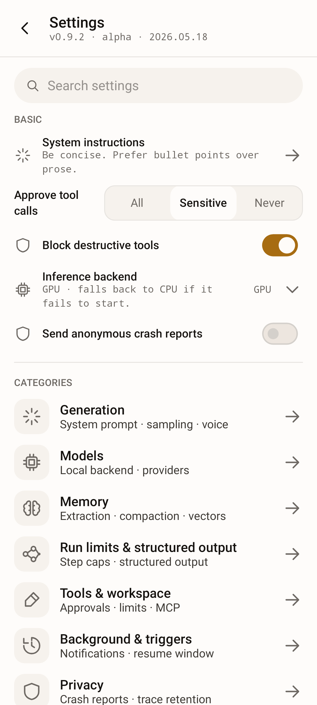

# Knotwork — on-device AI agent for Android

[](https://github.com/alexeyw/knotwork/actions/workflows/check.yml)
[](https://github.com/alexeyw/knotwork/actions/workflows/instrumented.yml)
[](LICENSE)


[](https://play.google.com/store/apps/details?id=app.knotwork.android)
[](https://f-droid.org/packages/app.knotwork.android/)

> **An AI agent you build, not just prompt.** A local-first Android agent whose
> behaviour you assemble from explicit, verifiable blocks — and by default every
> risky action waits for your confirmation. Its model runs on the phone, so a
> typical conversation never leaves the device.

<!--
  Hero visual: an on-device Share Handler demo loop (light/dark). Keep the
  <picture> element so prefers-color-scheme swaps the theme on GitHub.
-->
<p align="center">
  <picture>
    <source media="(prefers-color-scheme: dark)" srcset="docs/images/hero-share-handler-dark.gif">
    
  </picture>
</p>

## What it is

Knotwork is an Android app that runs a language model on your phone and lets
you decide what happens to a request on the way to an answer. Inference runs
**on-device** through [LiteRT-LM](https://ai.google.dev/edge) (Google's
on-device runtime, formerly TensorFlow Lite); a cloud model is used only once you
add its key.

Every conversation goes through a pipeline — what Tasker, n8n or Zapier would
call a *workflow*: a graph of typed nodes (input, on-device LLM, optional cloud
LLM, tool calls, routing, decomposition, evaluation, clarifications, output)
that you edit in the app or in a standalone browser editor. By default, a
sensitive or destructive tool call — writing a file, calling a tool on an MCP
server — shows you the call and waits for your answer.

## Who it's for

Knotwork is for someone with a recent Android phone who already uses Tasker,
Obsidian, Home Assistant or a local model, and who wants to see and change what
their agent does with their data.

It is deliberately **not** a mass-market "ask a question, get an answer"
assistant. Gemini already does that for free and is built into the OS.

## When Knotwork is not the right tool

- You want a chat window onto a model running on your own server. Knotwork can
  use that server, but the server's own client is simpler if the chat is all you
  need.
- You want quick answers to questions. The assistant built into your phone is
  free and already there.
- Your phone cannot spare about 2 GB of RAM for a model. The app still works
  with a cloud provider or your own server, but then the main reason to use it
  is gone.
- You want an agent that writes and runs its own code, or operates other apps'
  screens for you. Knotwork does neither, and neither is planned.

## Known limitations

What the app does not do, and what would change each item, is kept in one list:
[docs/faq.md § Known limitations](docs/faq.md#known-limitations).

## See it work

The **Share Handler** scenario is a good one-glance picture of the whole idea:
share an article, a message, or a screenshot to Knotwork from any app, and an
on-device model turns it into a clean, structured note in your inbox — pausing
to ask before it writes the file.

On first launch you pick a ready-made scenario. Knotwork makes its pipeline your
default, sets up the entry point it uses and downloads the model it needs,
showing the size and progress, then opens a working chat. **Start from
scratch** skips this.

https://github.com/user-attachments/assets/2ea06de5-6832-4e0c-ad48-430f375d8b72

> The animation at the top is a screen recording from a phone.

## Highlights

- On-device inference through LiteRT-LM: faster with a GPU, slower on CPU
  alone. Cloud providers (OpenAI, Anthropic, Google Gemini, DeepSeek,
  OpenRouter, Groq) and a server you run (Ollama, or any OpenAI-compatible one —
  vLLM, LM Studio, llama.cpp) are optional and use your own key. **Test
  connection** checks a provider or an MCP server without sending a prompt.
- A pipeline editor with 14 node types, a searchable list for adding them,
  auto-layout and inline validation — in the app, and as a
  [browser editor](pipeline-editor.html) in one HTML file that opens from disk
  with no network. Prompt variables such as `$DATE`, `$TOOLS` or
  `$MEMORY_SUMMARY` are filled in fresh on every run. Prompts import and export
  as Markdown files; a prompt file brings wording only and cannot add tools or
  steps.
- Built-in tools, such as Wikipedia search, files in the app's own workspace,
  scheduling and HTTP requests to hosts you allow, and tools from Model Context
  Protocol (MCP) servers you connect, plus reusable **skills** (an instruction
  with a tool allowlist). By default a sensitive or destructive call stops for
  your confirmation, and the card shows what you asked next to what the agent
  wants to run. The allowlist is enforced where the tool runs.
- A share target, launcher shortcuts and a Quick Settings tile run the pipeline
  you choose. **Triggers** (time, charging, Wi-Fi, network) start a pipeline on
  their own and report back with a notification. None of these does anything
  until you bind a pipeline to it.
- Tasker, MacroDroid or a script over `adb` can ask the agent to run one
  pipeline you nominate. It is off by default and behind a consent dialog, and a
  request naming any other pipeline is refused. Every request, accepted or
  refused, lands in a journal you can export.
- The database is encrypted with SQLCipher, and API keys are sealed with AES-GCM
  under an Android Keystore key. Usage statistics and journal exports have no
  network path, and a build check keeps it that way. Images you attach never go
  to a cloud model, and voice input is transcribed on the phone. The **FOSS
  build** has no proprietary dependencies.
- Structured steps check the model's output and ask it to fix a malformed
  answer, and cloud calls retry transient failures. An interrupted run resumes
  from its last completed node. A run nobody is watching stops at step and token
  limits counted across the whole run tree, and says why it stopped.
- Every run records its seed, sampler, versions and the SHA-256 of each model
  file it used. From the console you can **verify** a finished run — its
  on-device calls are repeated from their recorded prompts and compared byte for
  byte, and tools never run again — **run it again with the same seed**, or
  **export its trace** as one JSON file. Promised on CPU, and on GPU at the same
  context window, on the same device; not on another phone, and nothing is
  signed.
- Long-term memory: facts extracted from conversations or saved by hand, found
  by meaning when a step reads memory, with a manager for search, provenance,
  compaction and JSON export and import. Memory search works in English — see
  [Known limitations](docs/faq.md#known-limitations).
- Archiving a chat takes it out of the drawer without deleting it. It stays
  readable and exportable on its own screen until you restore it.
- **Back up and restore** what you made — chats, memory, pipelines, run history,
  triggers, settings and files — as one file locked with a password you choose,
  saved wherever you pick; restore it on this phone or a new one. API keys go in
  only if you tick the box; model files stay out, and the restored app offers to
  download them again. The [format](docs/backup-format.md) is public.
- Settings with a number, a borrowed term or a side effect explain themselves in
  one sentence behind the **ⓘ** next to the label. The reference table in the
  user guide is generated from the same strings.
- **More → Help** lists the user guide, FAQ, cookbook, troubleshooting page and
  automation contract. The FAQ and the troubleshooting page ship inside the app
  and read offline; the rest open in a browser at the tag of the version you
  installed. The build fails if a link points at a heading that no longer
  exists.

The full feature tour lives in the [user guide](docs/user-guide.md).

## Screenshots

The pipeline editor below is a capture from a phone running the app. The other
three are rendered at 1080 × 2400 from a Roborazzi baseline
(`./gradlew :catalog:recordRoborazziDebug --tests "*HeroSnapshotTest*"`), which
keeps them and the design-system regression suite in sync — the editor canvas is
an app screen rather than a design-system component, so it has no baseline to
render from. Hover over (or tap) an image to see the dark variant via your
browser's `prefers-color-scheme`.

<table>
  <tr>
    <td align="center">
      <picture>
        <source media="(prefers-color-scheme: dark)" srcset="docs/images/hero-pipeline-canvas-dark.jpg">
        
      </picture>
      <br><sub><b>Pipeline editor</b> — a 22-node pipeline on the canvas: routers, nested sub-pipelines, queues, tools, on-device and cloud steps</sub>
    </td>
    <td align="center">
      <picture>
        <source media="(prefers-color-scheme: dark)" srcset="docs/images/hero-pipeline-library-dark.png">
        
      </picture>
      <br><sub><b>Pipeline library</b> — saved pipelines + import-from-browser-editor JSON</sub>
    </td>
  </tr>
  <tr>
    <td align="center">
      <picture>
        <source media="(prefers-color-scheme: dark)" srcset="docs/images/hero-tools-dark.png">
        
      </picture>
      <br><sub><b>Tools</b> — built-in AppFunctions + MCP servers with per-tool risk + toggle</sub>
    </td>
    <td align="center">
      <picture>
        <source media="(prefers-color-scheme: dark)" srcset="docs/images/hero-settings-dark.png">
        
      </picture>
      <br><sub><b>Settings</b> — searchable hub with inline <i>Basic</i> controls over eight category sub-screens</sub>
    </td>
  </tr>
</table>

## Requirements

- **Android 14 or newer** (API level 34+). One OS-integration feature needs
  Android 16: the strict intent-matching rules that harden the
  external-automation entry point. On Android 14 and 15 everything else — local
  models, cloud providers, MCP servers, triggers, scheduled tasks — works
  unchanged. (Calling AppFunctions that *other* apps expose is not on this list
  at any API level: it needs a permission Android grants to privileged system
  apps only, so an ordinary install cannot do it. Publishing them, which this
  app does, is open to any app.)
- Approximately **2 GB of free RAM** available for the LLM at runtime.
- Optional: **GPU** acceleration for noticeably faster inference. CPU-only
  operation works but is slower. The NPU is not used: LiteRT-LM needs a
  vendor dispatch library and a model compiled for the chip, and the app
  ships neither.
- Optional: **location permission**, requested only if you scope a Wi-Fi
  trigger to specific network names (Android ties the Wi-Fi name to location).
  Nothing else uses it, and the name never leaves the device.
- To build from source: **JDK 21** and the Android SDK (the Android Studio
  bundled JBR already ships JDK 21). See [CONTRIBUTING.md](CONTRIBUTING.md) for
  the full dev setup.

## Install

### From Google Play

[**Knotwork on Google Play**](https://play.google.com/store/apps/details?id=app.knotwork.android)
— the simplest route, and the one that updates itself. Requires Android 14+.

The Play build is the `full` flavour described below. Google Play signs the
copies it delivers with its own key; the APKs on the Releases page and on
F-Droid carry this project's key. Android will not update one with the other,
so moving between Google Play and either of them means making a backup,
uninstalling, installing from the other channel and restoring the backup.
Which channel is signed by which key is set out in
[docs/release.md](docs/release.md#signing-identities-by-channel).

### From F-Droid

[**Knotwork on F-Droid**](https://f-droid.org/packages/app.knotwork.android/)
— the `foss` flavour, built by F-Droid from source. Requires Android 14+.

F-Droid publishes a version only when its own build matches the APK on the
Releases page, and then ships that APK. So the F-Droid copy and the release
APKs carry the same key and update each other in place. A new version reaches
F-Droid after the Releases page, once F-Droid's next build has run.

### From a release build

Grab the latest APK from the
[**Releases**](https://github.com/alexeyw/knotwork/releases) page and install it
on an Android 14+ device. Two flavours are published:

- **`full`** — the standard build, with opt-in Firebase Crashlytics for
  anonymous crash reporting (off by default, never collects message content).
- **`foss`** — zero proprietary dependencies and no crash reporting, the build
  F-Droid distributes. See [docs/release.md](docs/release.md) § *FOSS / F-Droid build*.

> **Upgrading from `0.6.0` or earlier requires a clean install.** Those builds
> were signed with the Android debug keystore; `0.7.0` is the first release
> signed with a real release key. Android refuses to update an install whose
> signer changed, so you must uninstall the old build — which clears its local
> data — before installing `0.7.0`. Export anything you want to keep first.
> This is a one-time break; later releases update in place.

### Build from source

```bash
git clone https://github.com/alexeyw/knotwork.git
cd knotwork
./gradlew assembleFullDebug
adb install app/build/outputs/apk/full/debug/app-full-debug.apk
```

### First run

Launch the app and let **scenario onboarding** guide you: pick a scenario and
Knotwork sets up its pipeline and downloads exactly the model it needs, then
opens into a working chat once the model has warmed. Prefer to wire things up
yourself? Choose **Start from scratch**, then open **Models**, download a
LiteRT model through the built-in manager (or paste a custom URL), and send your
first message once it loads.

Stuck on which buttons to press, or wondering whether something is supported
at all? [docs/faq.md](docs/faq.md) answers both, briefly.

## Tech stack

| Layer            | Technology                                              |
|------------------|---------------------------------------------------------|
| Language         | Kotlin                                                  |
| UI               | Jetpack Compose + Material Design 3                     |
| Design system    | Knotwork (in-tree `:catalog` library)                   |
| Brand fonts      | Inter + JetBrains Mono (bundled TTF, SIL OFL 1.1)       |
| LLM engine       | LiteRT-LM (Google Edge AI / ex-TensorFlow Lite)         |
| Tool calling     | AppFunctions Jetpack                                    |
| MCP & cloud LLM  | Koog (MCP transport + cloud-LLM client only)            |
| Architecture     | Clean Architecture + MVVM                               |
| DI               | Hilt                                                    |
| Async            | Coroutines / Flow                                       |
| Serialization    | kotlinx.serialization (structured-output validation)    |
| Network          | OkHttp + Ktor (via Koog)                                |
| Image loading    | Coil 3 (attachment thumbnails / viewer)                 |
| Local storage    | Room + DataStore                                        |
| Backup archive   | Argon2id (Bouncy Castle, MIT) + AES-256-GCM; [format](docs/backup-format.md) |
| Crash reporting  | Firebase Crashlytics (`full` flavour) / none (`foss`)   |
| Distribution     | `full` (Play / direct APK) + `foss` (F-Droid, no Google)|
| Testing          | JUnit + MockK; instrumented suite on an emulator matrix in CI |
| Architecture tests | Konsist (Clean-Architecture layer guard, in `check`)  |

## Privacy

Knotwork has no account, no sign-in, and no server of its own. There is nothing
to log into, and nothing is uploaded for the app to work.

- **Conversations stay on the device by default.** Inference runs locally
  through LiteRT-LM. Data leaves the phone only along the paths listed in
  [PRIVACY.md § 3](PRIVACY.md#3-what-can-leave-your-device): a cloud LLM node
  or memory embedding with your own API key, `delegate_task`, an MCP server you
  added, a model download, an `http_request` call to a host you allowed, and (in
  the `full` build) the crash reports below — all opt-in — plus the built-in
  `search_tool`, which is **on from the first launch**
  and looks topics up on Wikipedia for the pipeline the app starts you with.
  Its switch is on the Tools screen, and *Block network from local model*
  withholds it too.
- **Usage statistics are local-only.** The in-app statistics are computed and
  stored on the device and are never transmitted; a build-time architecture
  guard fails the build if any network dependency reaches that code. Exporting
  them is a manual action you take.
- **Crash reporting is opt-in and off by default.** In the `full` flavour you
  can enable anonymous crash reports (stack traces, device model, Android and
  app version, the active pipeline and model identifiers). Message content,
  prompts, memory, and API keys are never included. The `foss` flavour has no
  crash-reporting dependency at all and hides the setting.
- **Sensitive data is encrypted at rest.** The local database — chats, long-term
  memory, run traces — is SQLCipher-encrypted, and API keys, the Hugging Face
  token, and MCP credentials are sealed with AES-GCM under a dedicated Android
  Keystore key.
- **Downloaded models are checked.** When Hugging Face names a model file's
  SHA-256 in its answer to the download, the file must match it or it is
  deleted. A file with no hash named — from another host, for instance — is
  installed but marked *Not verified*.
- **The agent asks before it acts.** By default, destructive and sensitive tool
  calls stop at a confirmation, including when a pipeline runs in the background
  from a trigger. A destructive call asks under every setting.

What the agent can reach on the phone, and how to check its traffic yourself,
is in [SECURITY.md](SECURITY.md#what-the-agent-can-reach-and-how-to-check).

The policy in full — what is stored on the device, every path that can send
data off it, and how to switch each one off — is [PRIVACY.md](PRIVACY.md). The
threat model behind it, including what is explicitly *out* of scope, is in
[SECURITY.md](SECURITY.md); the per-feature behaviour is in the
[user guide](docs/user-guide.md).

## Documentation

The FAQ and the troubleshooting guide also ship **inside the app** and read with
no network: open **More → Help**. The other documents are listed there too and
open in a browser.

- Architecture overview — [docs/architecture.md](docs/architecture.md).
- User guide — [docs/user-guide.md](docs/user-guide.md).
- Pipeline cookbook — what every node type does, which of its settings
  actually change a run, and importable recipes —
  [docs/cookbook.md](docs/cookbook.md).
- Frequently asked questions, and the standing list of what the app
  deliberately does not do — [docs/faq.md](docs/faq.md).
- Troubleshooting — [docs/troubleshooting.md](docs/troubleshooting.md).
- External-automation contract (calling the agent from Tasker, MacroDroid or
  `adb`) — [docs/external-automation.md](docs/external-automation.md).
- Extending the agent (new node types, tools, providers, prompt
  variables) — [docs/extending.md](docs/extending.md).
- Code style — [docs/code-style.md](docs/code-style.md).
- Testing strategy and coverage — [docs/testing.md](docs/testing.md).
- API & integration conventions — [docs/api-conventions.md](docs/api-conventions.md).
- Release-build playbook (R8, signing, AAB, APK size) — [docs/release.md](docs/release.md).
- Decisions that constrain contributions — [docs/decisions/](docs/decisions/README.md).
- Roadmap — [docs/roadmap.md](docs/roadmap.md).
- Contributing guide — [CONTRIBUTING.md](CONTRIBUTING.md).
- Code of Conduct — [CODE_OF_CONDUCT.md](CODE_OF_CONDUCT.md).
- Privacy policy — [PRIVACY.md](PRIVACY.md).
- Security policy and threat model — [SECURITY.md](SECURITY.md).
- Release notes and version history — [CHANGELOG.md](CHANGELOG.md).

## Pre-release notice

This project is currently at **version 0.12.2** and is published for review and
experimentation. Expect rough edges:

- There are no stability guarantees for the public surface (Kotlin APIs,
  pipeline JSON schema, settings layout) between versions.
- On-device storage formats (encrypted preferences, exported pipeline JSON)
  may still change between versions.
- **Shared pipeline files are not yet a compatibility contract.** Exports carry
  a version stamp (`schemaVersion: 1`, `bundleVersion: 1`), but before 1.0 it is
  only a marker: the format can change without a new stamp, and nothing migrates
  an old file on import. A file whose stamp does not match is imported on a
  best-effort basis behind a warning, and every import names the settings it
  could not read. Keep the original file. From 1.0, a breaking change will mean
  a new major `schemaVersion` and a migration on import.
- **Upgrades preserve local data.** Every Room schema-version bump ships with
  an explicit migration, so an in-place update keeps your chat history,
  long-term memory, run traces, custom pipelines, and saved presets / prompt
  templates. (Note: *downgrading* to an older build recreates the database
  empty — forward migrations cannot be reversed — so export anything you want
  to keep before installing an older version.)

This README describes the `main` branch, which can be ahead of the latest
release; see *Unreleased* in [CHANGELOG.md](CHANGELOG.md) for what is not
released yet.

## License

Released under the Apache License 2.0. See [LICENSE](LICENSE) for the full
text.
